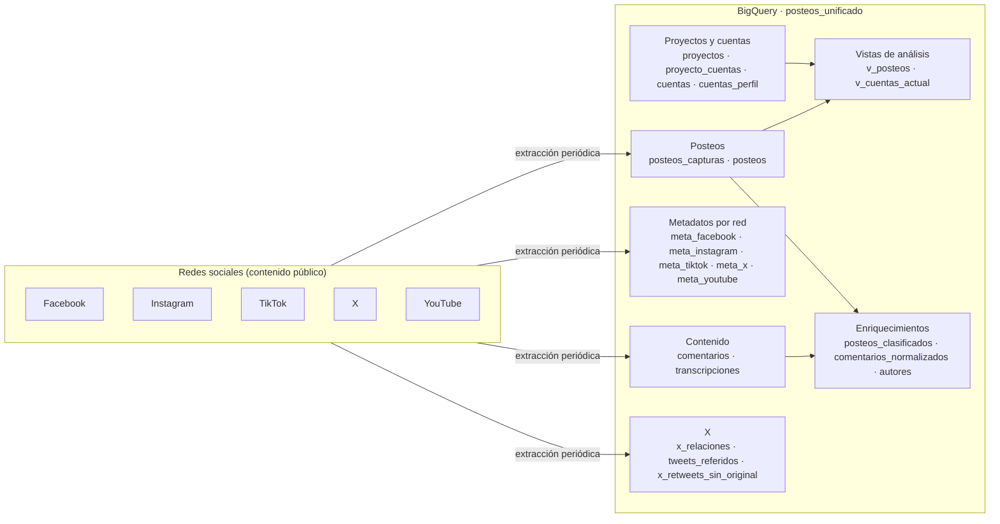

# Arquitectura de datos — `posteos_unificado`

Documentación del modelo de datos de **Posteos**: publicaciones, comentarios y transcripciones de cuentas públicas de Facebook, Instagram, TikTok, X y YouTube, almacenadas en BigQuery para análisis.

| Dato | Valor |
|---|---|
| Proyecto GCP | `cordoba-489013` |
| Dataset | `posteos_unificado` |
| Región | `southamerica-east1` |
| Redes | `facebook`, `instagram`, `tiktok`, `x`, `youtube` |
| Proyectos de análisis | Ver tabla `proyectos` |

---

## Índice

| # | Documento | Contenido |
|---|---|---|
| 01 | [Modelo de datos](01_modelo_de_datos.md) | Diagramas entidad-relación, cardinalidades, claves, partición y clustering |
| 02 | [Diccionario de datos](02_diccionario/) | Una ficha por tabla y vista |
| 02.1 | [Proyectos y cuentas](02_diccionario/01_proyectos_y_cuentas.md) | `proyectos`, `proyecto_cuentas`, `cuentas`, `cuentas_perfil`, `v_cuentas_actual`, `cuentas_alias`, `cuentas_ids_alternativos`, `cuentas_pendientes`, `correcciones_maestro` |
| 02.2 | [Posteos](02_diccionario/02_posteos.md) | `posteos_capturas`, `posteos`, `v_posteos` |
| 02.3 | [Metadatos por red](02_diccionario/03_metas_por_red.md) | `meta_facebook`, `meta_instagram`, `meta_tiktok`, `meta_x`, `meta_youtube` |
| 02.4 | [Comentarios y transcripciones](02_diccionario/04_comentarios_y_transcripciones.md) | `comentarios`, `transcripciones` |
| 02.5 | [Enriquecimientos](02_diccionario/05_enriquecimientos.md) | `posteos_clasificados`, `comentarios_normalizados`, `autores` |
| 02.6 | [X: relaciones](02_diccionario/06_x_relaciones.md) | `x_relaciones`, `tweets_referidos`, `x_retweets_sin_original` |
| 03 | [Reglas del modelo](03_reglas_de_negocio.md) | Resolución de cuentas, fechas, corte de día, unicidad, tratamiento de X |
| 04 | [Guía de consultas](04_guia_de_consultas.md) | Buenas prácticas de costo y consultas tipo |
| 05 | [Equivalencias con la estructura anterior](05_estructura_anterior.md) | Cómo traducir consultas de los datasets por categoría |
| 06 | [Glosario](06_glosario.md) | Términos usados |

---

## Vista general

## Principios del modelo

1. **Un solo dataset, una tabla por concepto.** Todas las categorías de cuentas y todos los proyectos conviven en las mismas tablas.
2. **Los hechos no llevan proyecto.** `posteos_capturas`, `posteos`, `comentarios` y `transcripciones` no tienen `proyecto_id`. El proyecto se obtiene por `cuentas` → `proyecto_cuentas` (o directamente con la vista `v_posteos`). Una cuenta puede pertenecer a varios proyectos sin duplicar datos.
3. **Claves naturales.** `red` + id nativo de la red (`post_id`, `comment_id`, `cuenta_id`, `author_id`). Todos los ids son `STRING`.
4. **Fechas en `TIMESTAMP` UTC.** Partición mensual por `time_created` (posteos, capturas, metas) o `timestamp` (comentarios).
5. **Historial de capturas.** Cada lectura de un posteo queda en `posteos_capturas` y `meta_<red>`; `posteos` tiene la más reciente.
6. **Vocabulario de `red` cerrado:** `facebook`, `instagram`, `tiktok`, `x`, `youtube`.
7. **X separa contenido propio de relaciones.** `posteos` solo contiene lo que la cuenta escribió; retweets, citas y respuestas como relación van a `x_relaciones` y los tweets referidos a `tweets_referidos`.
8. **Día argentino.** Un posteo pertenece al día de su publicación en hora argentina (UTC−3).

## Antes de consultar

- Configurar **Maximum bytes billed** y filtrar siempre por la columna de partición ([04](04_guia_de_consultas.md)).
- Para informes por proyecto usar `v_posteos` filtrando por `proyecto_id`.
- Las tablas con prefijo `bk_` o `_stg_` y la tabla `x_timeline_stg` son internas: no usarlas para análisis.

## Datos personales

Solo se recolecta contenido de páginas y perfiles públicos. Los datos de autores de comentarios se anonimizan en las salidas de análisis; los atributos de `autores` son estimaciones estadísticas, no datos declarados.
