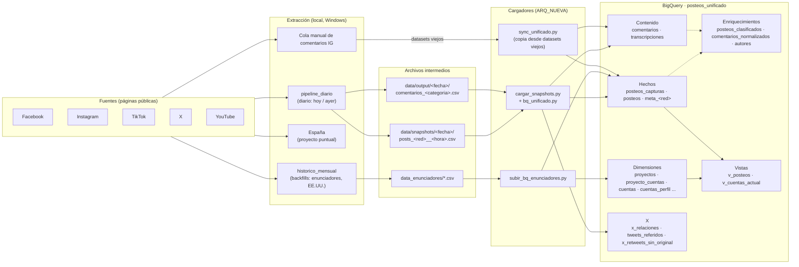

# Arquitectura nueva de datos — `posteos_unificado`

Documentación técnica del modelo de datos unificado del proyecto **Posteos**: extracción de publicaciones y comentarios de cuentas públicas de redes sociales (Facebook, Instagram, TikTok, X y YouTube) y su almacenamiento en BigQuery para análisis.

| Dato | Valor |
|---|---|
| Proyecto GCP | `cordoba-489013` |
| Dataset | `posteos_unificado` |
| Región | `southamerica-east1` |
| Redes | `facebook`, `instagram`, `tiktok`, `x`, `youtube` |
| Proyectos / clientes | `cordoba`, `san_luis`, `estados_unidos`, `rosario`, `espana`, `enunciadores` (tabla `proyectos`) |
| Estado | Construida sobre backups del 04/11/2026; alimentada en paralelo con la arquitectura vieja (ver [06](06_migracion_y_estado.md)) |

> Las cifras de filas de esta documentación corresponden a la foto del **04/11/2026**. Para actualizarlas, correr [`sql/D1_relevamiento_documentacion.sql`](sql/D1_relevamiento_documentacion.sql).

---

## Índice

| # | Documento | Contenido |
|---|---|---|
| 01 | [Modelo de datos](01_modelo_de_datos.md) | Diagramas entidad-relación (general y por dominio), cardinalidades, claves |
| 02 | [Diccionario de datos](02_diccionario/) | Una ficha por tabla y vista: propósito, grano, clave, partición, clustering, columnas, reglas y consultas de ejemplo |
| 02.1 | [Proyectos y cuentas](02_diccionario/01_proyectos_y_cuentas.md) | `proyectos`, `proyecto_cuentas`, `cuentas`, `cuentas_perfil`, `v_cuentas_actual`, `cuentas_alias`, `cuentas_ids_alternativos`, `cuentas_pendientes`, `correcciones_maestro` |
| 02.2 | [Posteos](02_diccionario/02_posteos.md) | `posteos_capturas`, `posteos`, `v_posteos` |
| 02.3 | [Metadatos por red](02_diccionario/03_metas_por_red.md) | `meta_facebook`, `meta_instagram`, `meta_tiktok`, `meta_x`, `meta_youtube` |
| 02.4 | [Comentarios y transcripciones](02_diccionario/04_comentarios_y_transcripciones.md) | `comentarios`, `transcripciones` |
| 02.5 | [Enriquecimientos](02_diccionario/05_enriquecimientos.md) | `posteos_clasificados`, `comentarios_normalizados`, `autores` |
| 02.6 | [X: relaciones](02_diccionario/06_x_relaciones.md) | `x_relaciones`, `tweets_referidos`, `x_retweets_sin_original`, `x_timeline_stg` |
| 02.7 | [Tablas auxiliares](02_diccionario/07_tablas_auxiliares.md) | Respaldos `bk_*` y staging `_stg_*` |
| 03 | [Reglas de negocio](03_reglas_de_negocio.md) | Resolución de cuentas, fechas y corte de día, deduplicación, tratamiento de X, proyectos |
| 04 | [Carga y pipelines](04_carga_y_pipelines.md) | Flujo de alimentación, scripts, orden de los MERGE, seguridad y costos |
| 05 | [Guía de consultas](05_guia_de_consultas.md) | Buenas prácticas de costo y consultas tipo |
| 06 | [Migración y estado](06_migracion_y_estado.md) | Diferencias con la arquitectura vieja, mapeo de columnas, fases, pendientes |
| 07 | [Glosario](07_glosario.md) | Términos del proyecto |

---

## Vista general

## Principios del modelo

1. **Un solo dataset, una tabla por concepto.** Reemplaza el esquema de un dataset por categoría (`medios`, `influencers`, `institucionales`, `san_luis`, `estados_unidos`, `rosario`, `dimensiones`).
2. **Los hechos no llevan proyecto.** `posteos_capturas`, `posteos`, `comentarios` y `transcripciones` no tienen `proyecto_id`. El proyecto se obtiene por `cuentas` → `proyecto_cuentas`. Una cuenta puede pertenecer a varios proyectos sin duplicar datos.
3. **Claves naturales.** `red` + id nativo de la red (`post_id`, `comment_id`, `cuenta_id`, `author_id`). Todos los ids son `STRING`.
4. **Fechas en `TIMESTAMP` UTC.** Partición mensual por `time_created` (posteos, capturas, metas) o `timestamp` (comentarios). Clustering por red e ids.
5. **Historial de capturas.** `posteos_capturas` y `meta_<red>` guardan cada captura (append); `posteos` guarda la última, con `n_capturas`.
6. **Vocabulario de `red` cerrado:** `facebook`, `instagram`, `tiktok`, `x`, `youtube` (`twitter` se normaliza a `x`).
7. **X en tres salidas.** `posteos` solo contiene lo que la cuenta escribió (original, reply, quote). Las relaciones (reply, quote, retweet) van a `x_relaciones`; los tweets referidos, a `tweets_referidos`.
8. **Corte de día argentino (UTC-3)** en todas las cargas nuevas.
9. **Cargas idempotentes.** Todo entra por `MERGE` por clave: reprocesar no duplica.

## Reglas para contribuir

- Toda consulta se corre con **Maximum bytes billed** y filtrando por la columna de partición (ver [05](05_guia_de_consultas.md)).
- Cada SQL de cambio lleva cabecera `PASO / HACE / COSTO / ESPERADO` y `ASSERT` cuando corresponda.
- Antes de modificar un script: copia `.<ext>.bak_AAAAMMDD_vN` junto al original.
- Los cargadores no escriben en BigQuery sin `--ejecutar` **y** `PIPELINE_UNIFICADO_BQ_OK=1`.
- Restricciones de BigQuery conocidas: no `CREATE VIEW` en un script con `CREATE TEMP FUNCTION`; `DECLARE` solo al inicio; sin DDL permanente dentro de transacciones; `__TABLES__.row_count` es `NULL` en vistas.
- Credenciales (`credenciales/`, cookies, `.env`) **nunca** se suben al repositorio.

## Gobierno de datos

Solo se extraen datos de páginas y perfiles públicos. Los datos de autores de comentarios se anonimizan en etapas posteriores del análisis; los atributos de `autores` son inferencias estadísticas, no datos declarados.
