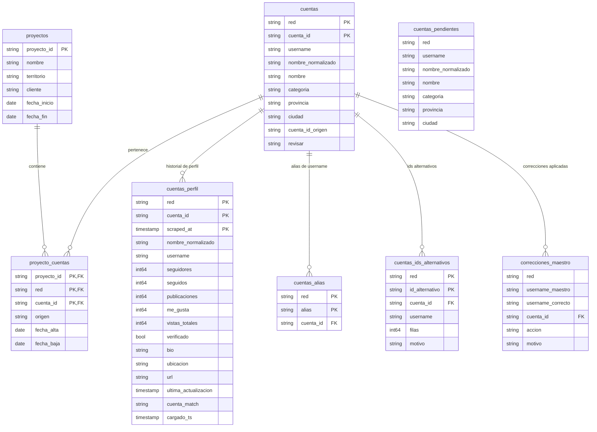
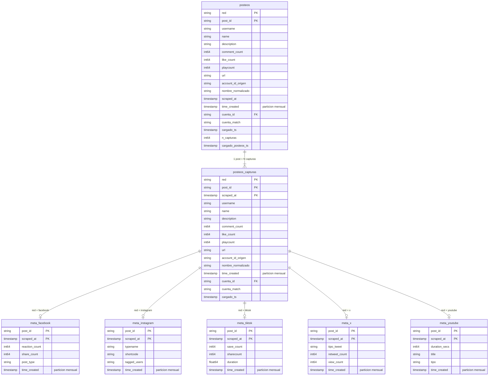
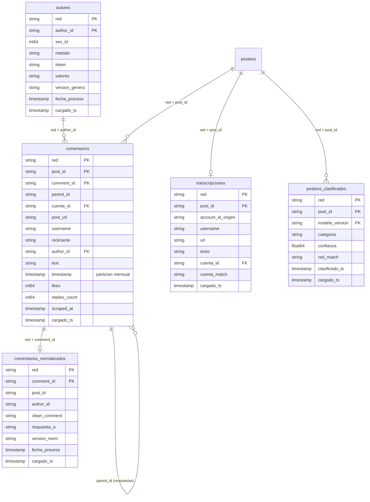
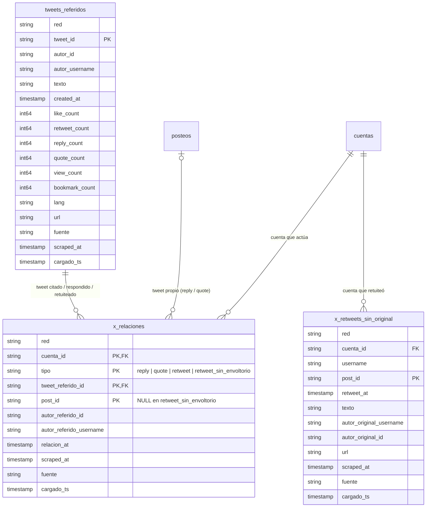
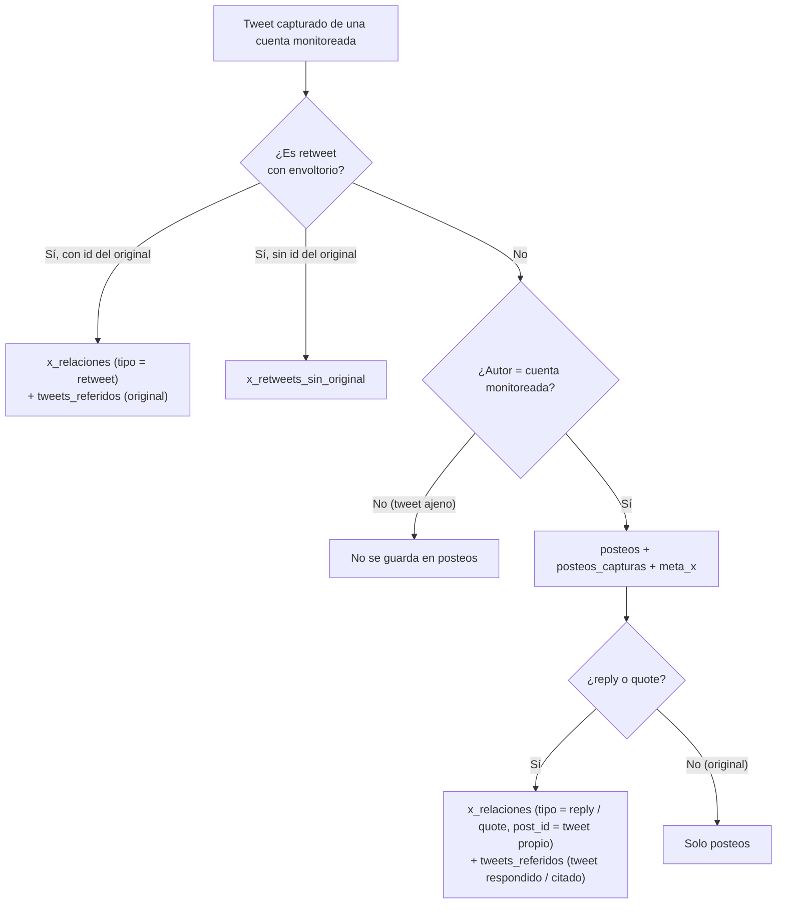

# 01 · Modelo de datos

[← Índice](README.md)

El dataset se organiza en seis dominios:

| Dominio | Tablas | Rol |
|---|---|---|
| Proyectos y cuentas | `proyectos`, `proyecto_cuentas`, `cuentas`, `cuentas_perfil`, `cuentas_alias`, `cuentas_ids_alternativos`, `cuentas_pendientes`, `correcciones_maestro` | Dimensiones: quién es cada cuenta y a qué proyecto pertenece |
| Posteos | `posteos_capturas`, `posteos` | Hechos: cada publicación y su historial de métricas |
| Metadatos por red | `meta_facebook`, `meta_instagram`, `meta_tiktok`, `meta_x`, `meta_youtube` | Campos propios de cada red, por captura |
| Contenido | `comentarios`, `transcripciones` | Comentarios de los posteos y transcripción de videos |
| X | `x_relaciones`, `tweets_referidos`, `x_retweets_sin_original` | Retweets, citas y respuestas como relaciones |
| Enriquecimientos | `posteos_clasificados`, `comentarios_normalizados`, `autores` | Salidas de modelos (clasificación, limpieza de texto, inferencia demográfica) |
| Vistas | `v_posteos`, `v_cuentas_actual` | Lectura para informes |

---

## 1. Diagrama general (claves)

```mermaid
erDiagram
    proyectos ||--o{ proyecto_cuentas : "proyecto_id"
    cuentas ||--o{ proyecto_cuentas : "red + cuenta_id"
    cuentas ||--o{ cuentas_perfil : "red + cuenta_id"
    cuentas ||--o{ cuentas_alias : "red + cuenta_id"
    cuentas ||--o{ cuentas_ids_alternativos : "red + cuenta_id"
    cuentas ||--o{ correcciones_maestro : "red + cuenta_id"
    cuentas |o--o{ posteos : "red + cuenta_id"
    cuentas |o--o{ posteos_capturas : "red + cuenta_id"
    cuentas |o--o{ comentarios : "red + cuenta_id (dueña del post)"
    cuentas |o--o{ transcripciones : "red + cuenta_id"
    posteos ||--|{ posteos_capturas : "red + post_id"
    posteos_capturas ||--o| meta_facebook : "post_id + scraped_at"
    posteos_capturas ||--o| meta_instagram : "post_id + scraped_at"
    posteos_capturas ||--o| meta_tiktok : "post_id + scraped_at"
    posteos_capturas ||--o| meta_x : "post_id + scraped_at"
    posteos_capturas ||--o| meta_youtube : "post_id + scraped_at"
    posteos ||--o{ comentarios : "red + post_id"
    posteos ||--o| transcripciones : "red + post_id"
    posteos ||--o{ posteos_clasificados : "red + post_id"
    comentarios ||--o| comentarios_normalizados : "red + comment_id"
    autores ||--o{ comentarios : "red + author_id"
    cuentas ||--o{ x_relaciones : "cuenta_id (red = x)"
    posteos |o--o{ x_relaciones : "post_id (reply / quote)"
    tweets_referidos ||--o{ x_relaciones : "tweet_id = tweet_referido_id"
    cuentas ||--o{ x_retweets_sin_original : "cuenta_id (red = x)"

    proyectos {
        string proyecto_id PK
    }
    proyecto_cuentas {
        string proyecto_id PK,FK
        string red PK,FK
        string cuenta_id PK,FK
    }
    cuentas {
        string red PK
        string cuenta_id PK
    }
    cuentas_perfil {
        string red PK,FK
        string cuenta_id PK,FK
        timestamp scraped_at PK
    }
    cuentas_alias {
        string red PK
        string alias PK
        string cuenta_id FK
    }
    cuentas_ids_alternativos {
        string red PK
        string id_alternativo PK
        string cuenta_id FK
    }
    correcciones_maestro {
        string red
        string cuenta_id FK
    }
    posteos {
        string red PK
        string post_id PK
        string cuenta_id FK
    }
    posteos_capturas {
        string red PK
        string post_id PK
        timestamp scraped_at PK
        string cuenta_id FK
    }
    meta_facebook {
        string post_id PK
        timestamp scraped_at PK
    }
    meta_instagram {
        string post_id PK
        timestamp scraped_at PK
    }
    meta_tiktok {
        string post_id PK
        timestamp scraped_at PK
    }
    meta_x {
        string post_id PK
        timestamp scraped_at PK
    }
    meta_youtube {
        string post_id PK
        timestamp scraped_at PK
    }
    comentarios {
        string red PK
        string post_id PK
        string comment_id PK
        string author_id FK
        string cuenta_id FK
    }
    transcripciones {
        string red PK
        string post_id PK
    }
    posteos_clasificados {
        string red PK
        string post_id PK
        string modelo_version PK
    }
    comentarios_normalizados {
        string red PK
        string comment_id PK
    }
    autores {
        string red PK
        string author_id PK
    }
    x_relaciones {
        string cuenta_id PK
        string tipo PK
        string tweet_referido_id PK
        string post_id PK
    }
    tweets_referidos {
        string tweet_id PK
    }
    x_retweets_sin_original {
        string cuenta_id
        string post_id PK
    }
```

---

## 2. Dominio: proyectos y cuentas

`cuentas_pendientes` no se relaciona: guarda cuentas conocidas **sin id nativo resuelto**. Cuando se resuelve el id, la cuenta pasa a `cuentas` (+ `proyecto_cuentas`).

---

## 3. Dominio: posteos y metadatos

Las tablas `meta_<red>` se muestran resumidas; el detalle completo está en [02.3](02_diccionario/03_metas_por_red.md). La red no figura como columna en las metas: la define la tabla.

---

## 4. Dominio: contenido y enriquecimientos

---

## 5. Dominio: X

---

## 6. Cardinalidades

| Origen | Destino | Cardinalidad | Unión |
|---|---|---|---|
| `proyectos` | `proyecto_cuentas` | 1 : N | `proyecto_id` |
| `cuentas` | `proyecto_cuentas` | 1 : N (una cuenta puede estar en varios proyectos) | `red`, `cuenta_id` |
| `cuentas` | `cuentas_perfil` | 1 : N (historial) | `red`, `cuenta_id` |
| `cuentas` | `cuentas_alias` | 1 : 0..N | `red`, `cuenta_id` |
| `cuentas` | `cuentas_ids_alternativos` | 1 : 0..N | `red`, `cuenta_id` |
| `cuentas` | `posteos`, `posteos_capturas`, `transcripciones` | 0..1 : N (`cuenta_id` puede ser NULL) | `red`, `cuenta_id` |
| `cuentas` | `comentarios` | 0..1 : N (cuenta dueña del post comentado) | `red`, `cuenta_id` |
| `posteos` | `posteos_capturas` | 1 : 1..N | `red`, `post_id` |
| `posteos_capturas` | `meta_<red>` | 1 : 0..1 | `post_id`, `scraped_at` (+ red implícita) |
| `posteos` | `comentarios` | 1 : 0..N | `red`, `post_id` |
| `posteos` | `transcripciones` | 1 : 0..1 | `red`, `post_id` |
| `posteos` | `posteos_clasificados` | 1 : 0..N (una por `modelo_version`) | `red`, `post_id` |
| `comentarios` | `comentarios_normalizados` | 1 : 0..1 | `red`, `comment_id` |
| `autores` | `comentarios` | 1 : N | `red`, `author_id` |
| `comentarios` | `comentarios` (respuestas) | 1 : 0..N | `parent_id` = `comment_id` |
| `tweets_referidos` | `x_relaciones` | 1 : N | `tweet_id` = `tweet_referido_id` |
| `posteos` (x) | `x_relaciones` | 0..1 : N | `post_id` |

> BigQuery no impone claves primarias ni foráneas: las claves de este documento son **lógicas**. Su unicidad la garantiza el proceso de carga.

## 7. Partición y clustering

| Tabla | Partición | Clustering |
|---|---|---|
| `posteos_capturas` | `TIMESTAMP_TRUNC(time_created, MONTH)` | `red`, `post_id` |
| `posteos` | `TIMESTAMP_TRUNC(time_created, MONTH)` | `red`, `post_id` |
| `meta_facebook` … `meta_youtube` | `TIMESTAMP_TRUNC(time_created, MONTH)` | `post_id` |
| `comentarios` | `TIMESTAMP_TRUNC(timestamp, MONTH)` | `red`, `post_id`, `comment_id` |
| `transcripciones` | — | `red`, `post_id` |
| `cuentas` | — | `red`, `cuenta_id` |
| `cuentas_perfil` | — | `red`, `cuenta_id` |
| `proyecto_cuentas` | — | `proyecto_id`, `red` |
| `posteos_clasificados` | — | `post_id` |
| `comentarios_normalizados` | — | `red`, `comment_id` |
| `autores` | — | `red`, `author_id` |
| `x_relaciones` | — | `cuenta_id`, `tipo` |
| `tweets_referidos` | — | `tweet_id` |
| `x_retweets_sin_original` | — | `cuenta_id` |
| resto (dimensiones chicas) | — | — |
