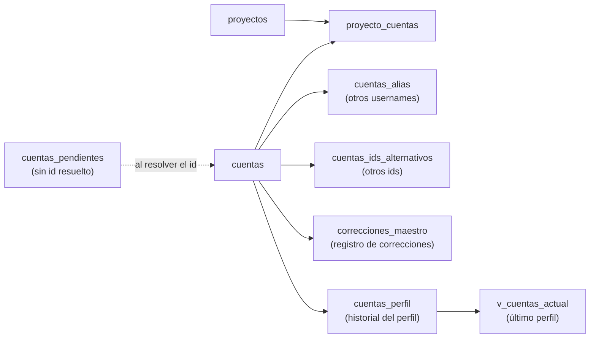

# 02.1 · Proyectos y cuentas

[← Diccionario](README.md)

Dimensiones del modelo: **quién es cada cuenta**, **a qué proyecto pertenece** y **cómo se identifica** a partir de su id, usuario, alias o nombre.



---

## `proyectos`

| Atributo | Valor |
|---|---|
| Propósito | Catálogo de proyectos de análisis |
| Grano | Un proyecto |
| Clave lógica | `proyecto_id` |
| Partición / clustering | — / — |
| Volumen de referencia | Menos de 10 filas |

| Columna | Tipo | Descripción |
|---|---|---|
| `proyecto_id` | STRING | Identificador corto en minúscula (p. ej. `cordoba`, `san_luis`, `estados_unidos`, `rosario`, `espana`, `enunciadores`). |
| `nombre` | STRING | Nombre legible del proyecto. |
| `territorio` | STRING | Ámbito geográfico del análisis. |
| `cliente` | STRING | Institución destinataria. NULL si no aplica. |
| `fecha_inicio` | DATE | Inicio del proyecto. NULL si no se registró. |
| `fecha_fin` | DATE | Cierre del proyecto. NULL si está activo. |

---

## `proyecto_cuentas`

| Atributo | Valor |
|---|---|
| Propósito | Pertenencia de cada cuenta a uno o más proyectos (tabla puente N:M) |
| Grano | Una cuenta en un proyecto |
| Clave lógica | `proyecto_id` + `red` + `cuenta_id` |
| Partición / clustering | — / `proyecto_id`, `red` |
| Volumen de referencia | ~1.600 filas |

| Columna | Tipo | Descripción |
|---|---|---|
| `proyecto_id` | STRING | Proyecto (→ `proyectos`). |
| `red` | STRING | Red de la cuenta. |
| `cuenta_id` | STRING | Id nativo de la cuenta (→ `cuentas`). |
| `origen` | STRING | Criterio por el que la cuenta se asignó al proyecto. |
| `fecha_alta` | DATE | Desde cuándo integra el proyecto. Hoy sin uso (NULL). |
| `fecha_baja` | DATE | Hasta cuándo. Hoy sin uso (NULL). |

> Una cuenta que está en dos proyectos tiene **dos filas** aquí y, por lo tanto, cada posteo suyo aparece **dos veces** en `v_posteos` si no se filtra por `proyecto_id`.

---

## `cuentas`

| Atributo | Valor |
|---|---|
| Propósito | Maestro de cuentas monitoreadas |
| Grano | Una cuenta de una red |
| Clave lógica | `red` + `cuenta_id` |
| Partición / clustering | — / `red`, `cuenta_id` |
| Volumen de referencia | ~1.600 filas |

| Columna | Tipo | Descripción |
|---|---|---|
| `red` | STRING | `facebook`, `instagram`, `tiktok`, `x`, `youtube`. |
| `cuenta_id` | STRING | Id nativo de la cuenta (Facebook: id de página; Instagram: id de usuario; TikTok: id de usuario; X: id de usuario; YouTube: id de canal). Nunca NULL. |
| `username` | STRING | Usuario vigente, en minúscula y sin `@`. |
| `nombre_normalizado` | STRING | Clave de la **entidad** (persona u organización) común a todas sus redes. Ver [reglas](../03_reglas_de_negocio.md#7-nombre_normalizado). |
| `nombre` | STRING | Nombre visible de la cuenta. |
| `categoria` | STRING | Tipo de actor (p. ej. medio, influencer, institucional, enunciador). |
| `provincia` | STRING | Provincia del actor. |
| `ciudad` | STRING | Ciudad del actor. |
| `cuenta_id_origen` | STRING | Id registrado originalmente para la cuenta, antes de verificarlo. |
| `revisar` | STRING | Observación de calidad sobre el id: `id_completado_desde_posteos` (el id se tomó del que domina en sus publicaciones) o `id_maestro_distinto_del_dominante_en_posteos` (diferencia a revisar). NULL si no hay observaciones. |

---

## `cuentas_perfil`

| Atributo | Valor |
|---|---|
| Propósito | Historial del perfil público de cada cuenta |
| Grano | Una lectura del perfil de una cuenta |
| Clave lógica | `red` + `cuenta_id` + `scraped_at` |
| Partición / clustering | — / `red`, `cuenta_id` |
| Frecuencia | Mensual |

| Columna | Tipo | Descripción |
|---|---|---|
| `red` | STRING | Red. |
| `cuenta_id` | STRING | Id nativo (→ `cuentas`). Puede ser NULL si no se pudo vincular. |
| `cuenta_match` | STRING | Cómo se vinculó el perfil con `cuentas` (`id`, `username`, …). |
| `nombre_normalizado` | STRING | Entidad. |
| `username` | STRING | Usuario al momento de la lectura. |
| `seguidores` | INT64 | Seguidores / suscriptores. |
| `seguidos` | INT64 | Cuentas seguidas (no aplica en YouTube). |
| `publicaciones` | INT64 | Cantidad de publicaciones informada por el perfil. |
| `me_gusta` | INT64 | Total de “me gusta” del perfil (TikTok; Facebook: likes de página). |
| `vistas_totales` | INT64 | Vistas acumuladas del canal (YouTube). |
| `verificado` | BOOL | Cuenta verificada. |
| `bio` | STRING | Biografía / descripción del perfil. |
| `ubicacion` | STRING | Ubicación declarada. |
| `url` | STRING | URL del perfil o enlace declarado. |
| `ultima_actualizacion` | TIMESTAMP | Fecha de actualización informada por la fuente. |
| `scraped_at` | TIMESTAMP | Momento de la lectura del perfil. |
| `cargado_ts` | TIMESTAMP | Momento de ingreso a BigQuery. |

---

## `v_cuentas_actual` (vista)

Último perfil de cada cuenta. Mismas columnas que `cuentas_perfil`; excluye perfiles sin `cuenta_id`.

```sql
SELECT * EXCEPT (rn) FROM (
  SELECT *, ROW_NUMBER() OVER (PARTITION BY red, cuenta_id ORDER BY scraped_at DESC, cargado_ts DESC) AS rn
  FROM `cordoba-489013.posteos_unificado.cuentas_perfil`
  WHERE cuenta_id IS NOT NULL
) WHERE rn = 1
```

---

## `cuentas_alias`

Usernames alternativos (anteriores o variantes) que apuntan a una cuenta.

| Columna | Tipo | Descripción |
|---|---|---|
| `red` | STRING | Red. |
| `alias` | STRING | Username alternativo, en minúscula. Clave junto con `red`. |
| `cuenta_id` | STRING | Cuenta a la que apunta. |

---

## `cuentas_ids_alternativos`

Ids nativos distintos observados para una misma cuenta.

| Columna | Tipo | Descripción |
|---|---|---|
| `red` | STRING | Red. |
| `cuenta_id` | STRING | Id adoptado como canónico. |
| `id_alternativo` | STRING | Otro id observado. Clave junto con `red`. |
| `username` | STRING | Username asociado. |
| `filas` | INT64 | Publicaciones observadas con el id alternativo. |
| `motivo` | STRING | Explicación del caso. |

---

## `cuentas_pendientes`

Cuentas conocidas cuyo id nativo aún no se resolvió. No tienen publicaciones vinculadas hasta que se resuelven y pasan a `cuentas`.

Columnas: `red`, `username`, `nombre_normalizado`, `nombre`, `categoria`, `provincia`, `ciudad` (mismo significado que en `cuentas`).

---

## `correcciones_maestro`

Registro de correcciones aplicadas al maestro de cuentas.

| Columna | Tipo | Descripción |
|---|---|---|
| `red` | STRING | Red. |
| `username_maestro` | STRING | Username que figuraba antes. |
| `username_correcto` | STRING | Username corregido. |
| `cuenta_id` | STRING | Cuenta afectada. |
| `accion` | STRING | Acción aplicada. |
| `motivo` | STRING | Justificación. |
