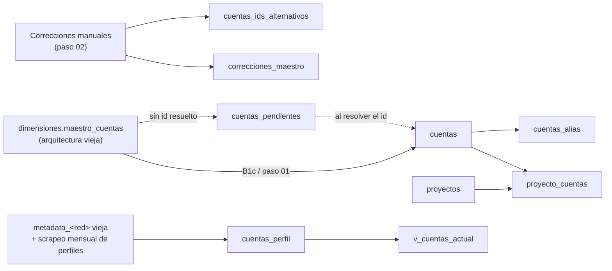

# 02.1 · Proyectos y cuentas

[← Diccionario](README.md)

Dimensiones del modelo. Responden **quién es cada cuenta** (maestro), **a qué proyecto pertenece** y **cómo se resuelve** una cuenta a partir de lo que trae un scraper (id, username, alias, nombre normalizado).



---

## `proyectos`

| Atributo | Valor |
|---|---|
| Propósito | Catálogo de proyectos / clientes de análisis |
| Grano | Un proyecto |
| Clave lógica | `proyecto_id` |
| Partición / clustering | — / — |
| Filas (04/11/2026) | 4 (luego se agregaron `espana` y `enunciadores`) |
| Escriben | `01_B1c_crear_dimensiones.sql` (alta inicial); altas manuales por SQL (`E1b_alta_enunciadores.sql`, alta de España) |
| Leen | `v_posteos`, informes |

| Columna | Tipo | Descripción |
|---|---|---|
| `proyecto_id` | STRING | Identificador corto en minúscula y sin espacios. Valores: `cordoba`, `san_luis`, `estados_unidos`, `rosario`, `espana`, `enunciadores`. |
| `nombre` | STRING | Nombre legible del proyecto (p. ej. `Cordoba`, `Elecciones España`). |
| `territorio` | STRING | Ámbito geográfico del análisis (p. ej. `Cordoba`, `España`, `Nacional`). |
| `cliente` | STRING | Institución destinataria (p. ej. `UNED`, `UNR`, `tesis`). NULL si no aplica. |
| `fecha_inicio` | DATE | Inicio del proyecto. NULL en los proyectos migrados. |
| `fecha_fin` | DATE | Cierre del proyecto. NULL si está activo. |

**Notas**
- `espana_29n` es un duplicado creado por error: **no usar**; el proyecto vigente es `espana`.
- Los valores `territorio='Nacional'` y `cliente='tesis'` de `enunciadores` están pendientes de confirmación.

---

## `proyecto_cuentas`

| Atributo | Valor |
|---|---|
| Propósito | Pertenencia de cada cuenta a uno o más proyectos (tabla puente N:M) |
| Grano | Una cuenta en un proyecto |
| Clave lógica | `proyecto_id` + `red` + `cuenta_id` |
| Partición / clustering | — / `proyecto_id`, `red` |
| Filas (04/11/2026) | 1.543 |
| Escriben | `01_B1c_crear_dimensiones.sql`, `22/25_X4c_alta_cuentas_x_eeuu_rosario`, `E1b_alta_enunciadores.sql`, `subir_bq_enunciadores.py`, altas de España |
| Leen | `v_posteos`; todo informe que filtra por proyecto |

| Columna | Tipo | Descripción |
|---|---|---|
| `proyecto_id` | STRING | Proyecto (→ `proyectos.proyecto_id`). |
| `red` | STRING | Red de la cuenta. |
| `cuenta_id` | STRING | Id nativo de la cuenta (→ `cuentas`). |
| `origen` | STRING | Cómo se determinó la pertenencia: `posteos` (la cuenta tenía posteos en el dataset viejo del proyecto), `provincia` (por la provincia del maestro), `matriz_enunciadores`, altas manuales. |
| `fecha_alta` | DATE | Desde cuándo la cuenta integra el proyecto. Hoy NULL (decisión 03/11/2026). |
| `fecha_baja` | DATE | Hasta cuándo. Hoy NULL. |

**Notas**
- Una cuenta en dos proyectos genera **dos filas** aquí y, por lo tanto, **dos filas por posteo** en `v_posteos` si no se filtra por `proyecto_id`.

---

## `cuentas`

| Atributo | Valor |
|---|---|
| Propósito | Maestro de cuentas monitoreadas |
| Grano | Una cuenta de una red |
| Clave lógica | `red` + `cuenta_id` |
| Partición / clustering | — / `red`, `cuenta_id` |
| Filas (04/11/2026) | 1.538 |
| Escriben | `01_B1c_crear_dimensiones.sql`, `05_B2e_completar_cuentas.sql`, `08_B2x_cerrar_pendientes.sql`, `09_B2y_normalizar_usernames.sql`, `X4c_alta_cuentas_x_eeuu_rosario`, `subir_bq_enunciadores.py` |
| Leen | Todos los cargadores (resolución de cuenta), `v_posteos` |

| Columna | Tipo | Descripción |
|---|---|---|
| `red` | STRING | `facebook`, `instagram`, `tiktok`, `x`, `youtube`. |
| `cuenta_id` | STRING | Id nativo de la cuenta en la red (Facebook: id de página; Instagram: pk; TikTok: id de usuario; X: `rest_id`; YouTube: `channel_id`). Nunca NULL en esta tabla. |
| `username` | STRING | Usuario/handle vigente, en minúscula y sin `@`. |
| `nombre_normalizado` | STRING | Clave canónica de la **entidad** (persona o medio) común a todas sus redes: nombre completo en minúscula, sin tildes y sin lo que va entre paréntesis. |
| `nombre` | STRING | Nombre visible de la cuenta. |
| `categoria` | STRING | Tipo de actor (p. ej. medio, influencer, institucional/funcionario, enunciador). Determina el ruteo de procesos y los informes. |
| `provincia` | STRING | Provincia del actor (p. ej. `Cordoba`, `San Luis`). |
| `ciudad` | STRING | Ciudad del actor. |
| `cuenta_id_origen` | STRING | Id que traía el maestro original antes de completarlo o corregirlo. |
| `revisar` | STRING | Marca de calidad de la migración: `id_completado_desde_posteos` (el maestro no tenía id y se tomó el id dominante —≥90 %— de los posteos) o `id_maestro_distinto_del_dominante_en_posteos` (conflicto a revisar). NULL si no hay observaciones. |

---

## `cuentas_perfil`

| Atributo | Valor |
|---|---|
| Propósito | Historial del perfil público de cada cuenta |
| Grano | Una captura del perfil de una cuenta |
| Clave lógica | `red` + `cuenta_id` + `scraped_at` |
| Partición / clustering | — / `red`, `cuenta_id` |
| Filas (04/11/2026) | 394 |
| Escriben | `06_B2n_crear_cuentas_perfil.sql`, `07_B2u_completar_pendientes_y_perfiles.sql`, `07b_cuentas_perfil_scraped_at.sql`; scrapeo **mensual** de perfiles |
| Leen | `v_cuentas_actual` |

| Columna | Tipo | Descripción |
|---|---|---|
| `red` | STRING | Red. |
| `nombre_normalizado` | STRING | Entidad (ver `cuentas`). |
| `username` | STRING | Usuario al momento de la captura. |
| `seguidores` | INT64 | Seguidores / suscriptores. |
| `seguidos` | INT64 | Cuentas seguidas (no aplica en YouTube). |
| `publicaciones` | INT64 | Cantidad de publicaciones informada por el perfil. |
| `me_gusta` | INT64 | Total de “me gusta” del perfil (TikTok; Facebook: likes de página). |
| `vistas_totales` | INT64 | Vistas acumuladas del canal (YouTube). |
| `verificado` | BOOL | Cuenta verificada. |
| `bio` | STRING | Biografía / descripción del perfil. |
| `ubicacion` | STRING | Ubicación declarada. |
| `url` | STRING | URL del perfil o enlace declarado. |
| `ultima_actualizacion` | TIMESTAMP | Fecha de actualización informada por la fuente (arquitectura vieja). |
| `cuenta_id` | STRING | Id nativo (→ `cuentas`). Puede ser NULL si no se resolvió. |
| `cuenta_match` | STRING | Cómo se vinculó el perfil con `cuentas` (`id`, `username`, …). |
| `cargado_ts` | TIMESTAMP | Momento de carga en BigQuery. |
| `scraped_at` | TIMESTAMP | Momento de captura del perfil. |

---

## `v_cuentas_actual` (vista)

Último perfil de cada cuenta. Mismas columnas que `cuentas_perfil`.

```sql
SELECT * EXCEPT (rn) FROM (
  SELECT *, ROW_NUMBER() OVER (PARTITION BY red, cuenta_id ORDER BY scraped_at DESC, cargado_ts DESC) AS rn
  FROM `cordoba-489013.posteos_unificado.cuentas_perfil`
  WHERE cuenta_id IS NOT NULL
) WHERE rn = 1
```

Los perfiles sin `cuenta_id` quedan fuera de la vista.

---

## `cuentas_alias`

| Atributo | Valor |
|---|---|
| Propósito | Usernames alternativos (anteriores, variantes) que apuntan a una cuenta |
| Grano | Un alias de una red |
| Clave lógica | `red` + `alias` |
| Filas (04/11/2026) | 17 |
| Escriben | `03_F1_03_alias_vacio.sql` (crea), `05_B2e_completar_cuentas.sql` (completa) |
| Leen | Cargadores: tercer paso de la resolución de cuenta |

| Columna | Tipo | Descripción |
|---|---|---|
| `red` | STRING | Red. |
| `alias` | STRING | Username alternativo, en minúscula. |
| `cuenta_id` | STRING | Cuenta a la que apunta. |

---

## `cuentas_ids_alternativos`

| Atributo | Valor |
|---|---|
| Propósito | Ids nativos distintos observados para una misma cuenta (registro de conflictos resueltos) |
| Grano | Un id alternativo |
| Clave lógica | `red` + `id_alternativo` |
| Filas (04/11/2026) | 3 |
| Escriben | `02_B1e_aplicar_correcciones.sql` |

| Columna | Tipo | Descripción |
|---|---|---|
| `red` | STRING | Red. |
| `cuenta_id` | STRING | Id canónico adoptado. |
| `id_alternativo` | STRING | Otro id observado para la misma cuenta. |
| `username` | STRING | Username asociado. |
| `filas` | INT64 | Cantidad de posteos observados con el id alternativo. |
| `motivo` | STRING | Explicación del caso. |

---

## `cuentas_pendientes`

| Atributo | Valor |
|---|---|
| Propósito | Cuentas conocidas cuyo id nativo todavía no se resolvió |
| Grano | Una cuenta pendiente |
| Clave lógica | ninguna formal (`red` + `username` en la práctica) |
| Filas | 3 al 04/11/2026; +49 cuentas del proyecto `enunciadores` (11/11/2026) |
| Escriben | `01_B1c_crear_dimensiones.sql`, `E1b_alta_enunciadores.sql` |
| Salida | Al resolver el id (desde `account_id_origen` de los posteos extraídos) la fila pasa a `cuentas` + `proyecto_cuentas` |

Columnas: `red`, `username`, `nombre_normalizado`, `nombre`, `categoria`, `provincia`, `ciudad` (mismo significado que en `cuentas`).

---

## `correcciones_maestro`

| Atributo | Valor |
|---|---|
| Propósito | Bitácora de correcciones aplicadas al maestro durante la migración |
| Grano | Una corrección |
| Filas (04/11/2026) | 5 |
| Escriben | `02_B1e_aplicar_correcciones.sql` |

| Columna | Tipo | Descripción |
|---|---|---|
| `red` | STRING | Red. |
| `username_maestro` | STRING | Username tal como figuraba en el maestro. |
| `username_correcto` | STRING | Username corregido. |
| `cuenta_id` | STRING | Cuenta afectada. |
| `accion` | STRING | Acción aplicada. |
| `motivo` | STRING | Justificación. |
