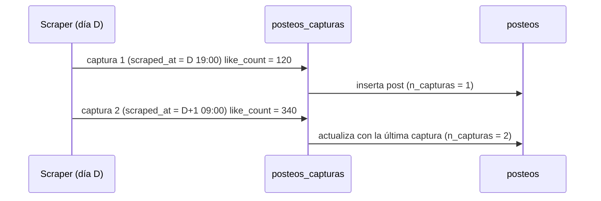

# 02.2 · Posteos

[← Diccionario](README.md)

Tablas de hechos centrales. Cada vez que un scraper ve un posteo se genera una **captura** (métricas en ese momento). `posteos_capturas` guarda todas las capturas; `posteos` guarda solo la última.



---

## `posteos_capturas`

| Atributo | Valor |
|---|---|
| Propósito | Historial de capturas de cada posteo, para comparar la evolución de métricas |
| Grano | Una captura de un posteo |
| Clave lógica | `red` + `post_id` + `scraped_at` |
| Partición | `TIMESTAMP_TRUNC(time_created, MONTH)` |
| Clustering | `red`, `post_id` |
| Filas (04/11/2026) | 1.037.743 (576,7 MB) |
| Escriben | `10_B2b_crear_posteos_capturas.sql` (migración); `bq_unificado.sql_capturas` vía `cargar_snapshots.py`; `sync_unificado.py`; `subir_bq_enunciadores.py` |
| Leen | `sql_posteos` (recalcula `posteos`), análisis de evolución |

| Columna | Tipo | Descripción |
|---|---|---|
| `red` | STRING | Red del posteo. |
| `post_id` | STRING | Id nativo del posteo (Facebook: id del post; Instagram: id/pk de media; TikTok: id del video; X: id del tweet; YouTube: id del video). |
| `username` | STRING | Usuario de la cuenta autora según el scraper. |
| `name` | STRING | Nombre visible de la cuenta autora según el scraper. |
| `description` | STRING | Texto del posteo (caption, cuerpo del tweet, descripción del video). |
| `comment_count` | INT64 | Comentarios informados por la red en esa captura. |
| `like_count` | INT64 | Me gusta / reacciones totales en esa captura. |
| `playcount` | INT64 | Reproducciones / vistas cuando la red las informa (TikTok, YouTube, videos de IG); NULL si no aplica. |
| `url` | STRING | Enlace al posteo. |
| `account_id_origen` | STRING | Id de cuenta tal como lo trajo el scraper (columna `account_id` de los CSV). Insumo para resolver `cuenta_id`. |
| `nombre_normalizado` | STRING | Entidad de la cuenta (del CSV o del lookup de `pipeline_diario/config/settings.py`). |
| `scraped_at` | TIMESTAMP | Momento de la captura, en UTC (el scraper lo escribe en hora argentina y el cargador suma 3 h). |
| `time_created` | TIMESTAMP | Momento de publicación, en UTC. Columna de partición. |
| `cuenta_id` | STRING | Cuenta resuelta (→ `cuentas`). NULL si `cuenta_match = 'sin_cuenta'`. |
| `cuenta_match` | STRING | Regla que resolvió la cuenta: `id`, `username`, `alias`, `nombre_normalizado` o `sin_cuenta`. Ver [03](../03_reglas_de_negocio.md#1-resolución-de-la-cuenta). |
| `cargado_ts` | TIMESTAMP | Momento en que la fila entró a BigQuery. |

**Reglas**
- Deduplicación: una fila por (`red`, `post_id`, `scraped_at`). En la migración, ante duplicados se conservó la de mayor `like_count`; el cargador diario usa `MERGE … WHEN NOT MATCHED THEN INSERT` (una captura existente no se pisa).
- X: no contiene retweets con envoltorio ni tweets de autores ajenos (ver [06](06_x_relaciones.md)).

---

## `posteos`

| Atributo | Valor |
|---|---|
| Propósito | Estado más reciente de cada posteo. **Tabla de uso general para análisis.** |
| Grano | Un posteo |
| Clave lógica | `red` + `post_id` |
| Partición | `TIMESTAMP_TRUNC(time_created, MONTH)` |
| Clustering | `red`, `post_id` |
| Filas (04/11/2026) | 1.010.778 (553,0 MB) |
| Escriben | `11_F1_05_posteos_metas_vista.sql` (migración); `bq_unificado.sql_posteos` (recalcula desde `posteos_capturas` los posts del lote); `sync_unificado.py`; `subir_bq_enunciadores.py` |
| Leen | `v_posteos`, `comentarios` (completa `cuenta_id`), informes, clasificador |

Columnas: todas las de `posteos_capturas` más:

| Columna | Tipo | Descripción |
|---|---|---|
| `n_capturas` | INT64 | Cantidad de capturas del posteo en `posteos_capturas`. |
| `cargado_posteos_ts` | TIMESTAMP | Momento en que se recalculó la fila de `posteos`. |

En `posteos`, `scraped_at` y las métricas corresponden a la **última captura** (orden `scraped_at DESC, cargado_ts DESC`).

**Consulta de ejemplo — posts y likes por red en un mes (poda de partición)**

```sql
SELECT red, COUNT(*) AS posts, SUM(like_count) AS likes
FROM `cordoba-489013.posteos_unificado.posteos`
WHERE time_created >= TIMESTAMP('2026-10-01') AND time_created < TIMESTAMP('2026-11-01')
GROUP BY red;
```

**Consulta de ejemplo — evolución de métricas de un posteo**

```sql
SELECT scraped_at, like_count, comment_count, playcount
FROM `cordoba-489013.posteos_unificado.posteos_capturas`
WHERE red = 'instagram' AND post_id = '<post_id>'
  AND time_created >= TIMESTAMP('2026-11-01') AND time_created < TIMESTAMP('2026-12-01')
ORDER BY scraped_at;
```

---

## `v_posteos` (vista)

| Atributo | Valor |
|---|---|
| Propósito | Posteos con los datos de la cuenta y del proyecto, para informes |
| Definición | `11b_F1_06_vista_y_verificacion.sql` |
| Grano | Un posteo **por proyecto** de su cuenta |

```sql
SELECT p.*,
       c.username AS cuenta_username, c.nombre AS cuenta_nombre, c.categoria, c.provincia, c.ciudad,
       pc.proyecto_id, pr.nombre AS proyecto_nombre, pr.cliente, pr.territorio
FROM posteos p
LEFT JOIN cuentas c           ON c.red = p.red AND c.cuenta_id = p.cuenta_id
LEFT JOIN proyecto_cuentas pc ON pc.red = p.red AND pc.cuenta_id = p.cuenta_id
LEFT JOIN proyectos pr        ON pr.proyecto_id = pc.proyecto_id
```

| Columna agregada | Origen | Descripción |
|---|---|---|
| `cuenta_username` | `cuentas.username` | Username del maestro (puede diferir de `username` del scraper). |
| `cuenta_nombre` | `cuentas.nombre` | Nombre del maestro. |
| `categoria`, `provincia`, `ciudad` | `cuentas` | Atributos de la cuenta. |
| `proyecto_id` | `proyecto_cuentas` | Proyecto. NULL si la cuenta no está en ningún proyecto o el posteo no tiene cuenta. |
| `proyecto_nombre`, `cliente`, `territorio` | `proyectos` | Atributos del proyecto. |

**Uso correcto**
- Filtrar **siempre** por `time_created` (poda de partición) y por `red`.
- Filtrar por `proyecto_id` para no duplicar posteos de cuentas compartidas entre proyectos.

```sql
SELECT categoria, red, COUNT(*) AS posts
FROM `cordoba-489013.posteos_unificado.v_posteos`
WHERE proyecto_id = 'cordoba'
  AND time_created >= TIMESTAMP('2026-11-01') AND time_created < TIMESTAMP('2026-11-08')
GROUP BY categoria, red;
```
