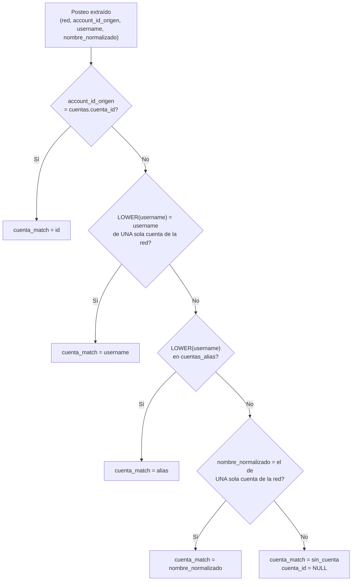

# 03 · Reglas del modelo

[← Índice](README.md)

## 1. Resolución de la cuenta

Cada posteo (y transcripción) llega con el id de cuenta informado por la red (`account_id_origen`), un `username` y a veces un `nombre_normalizado`. La cuenta se resuelve en este orden; la primera regla que encuentra coincidencia gana y queda registrada en `cuenta_match`.



- Las búsquedas por `username` y `nombre_normalizado` solo aplican si identifican **una única** cuenta en la red (`HAVING COUNT(*) = 1`).
- Usernames de cuentas con ids ajenos o ambiguos no se resuelven por username.
- `x_relaciones` usa id → username → alias (sin `nombre_normalizado`) y descarta lo que no resuelve.
- `comentarios.cuenta_id` es la cuenta dueña del posteo comentado.

## 2. Fechas y zonas horarias

Todas las fechas se guardan como `TIMESTAMP` en **UTC**. Para expresarlas en hora argentina:

```sql
DATETIME(time_created, 'America/Argentina/Buenos_Aires')
```

| Campo | Significado |
|---|---|
| `time_created` | Publicación del posteo |
| `scraped_at` | Lectura (captura) del dato |
| `timestamp` (comentarios) | Publicación del comentario |
| `cargado_ts` | Ingreso a BigQuery |
| `scraped_ts_inferido = TRUE` (metas) | Momento de captura asignado por aproximación en registros históricos |

Argentina = UTC−3, sin horario de verano.

## 3. Corte de día

Un posteo pertenece al **día argentino** de su `time_created`:

```
dia_argentino = DATE(time_created - 3 h)
```

Para contar posteos por día usar siempre el día argentino:

```sql
DATE(time_created, 'America/Argentina/Buenos_Aires') AS dia_arg
```

Un posteo publicado el 05/11 a las 22:30 hora argentina (06/11 01:30 UTC) pertenece al **05/11**.

## 4. Unicidad

| Tabla | Una fila por | Si el dato se vuelve a leer |
|---|---|---|
| `posteos_capturas` | `red`, `post_id`, `scraped_at` | Se agrega una captura nueva |
| `posteos` | `red`, `post_id` | Se reemplaza por la última captura y suma `n_capturas` |
| `meta_<red>` | `post_id`, `scraped_at` | Se agrega una captura nueva |
| `comentarios` | `red`, `post_id`, `comment_id` | Se actualizan `likes`, `replies_count`, `scraped_at` |
| `transcripciones` | `red`, `post_id` | Se conserva la transcripción más completa |
| `x_relaciones` | `cuenta_id`, `tipo`, `tweet_referido_id`, `post_id` | Sin cambios |
| `tweets_referidos` | `tweet_id` | Se conserva la primera lectura; solo se completan vacíos |

## 5. Proyectos

- Los hechos no tienen proyecto. Proyecto de un posteo = `proyecto_cuentas` de su cuenta.
- Una cuenta en dos proyectos aparece dos veces en `v_posteos`: filtrar por `proyecto_id`.
- Las publicaciones sin cuenta resuelta (`cuenta_id` NULL) no aparecen asociadas a ningún proyecto.

## 6. Vocabulario

| Campo | Valores |
|---|---|
| `red` | `facebook`, `instagram`, `tiktok`, `x`, `youtube` |
| `cuenta_match` | `id`, `username`, `alias`, `nombre_normalizado`, `sin_cuenta` |
| `x_relaciones.tipo` | `reply`, `quote`, `retweet`, `retweet_sin_envoltorio` |
| `meta_x.tipo_tweet` | `original`, `reply`, `quote` |
| `posteos_clasificados.modelo_version` | `bert_v1` |

## 7. `nombre_normalizado`

Clave canónica de la entidad, común a todas sus redes: nombre completo en **minúscula**, **sin tildes** y **sin lo que va entre paréntesis** (apodos, siglas). Permite agrupar la presencia multiplataforma de un mismo actor.
