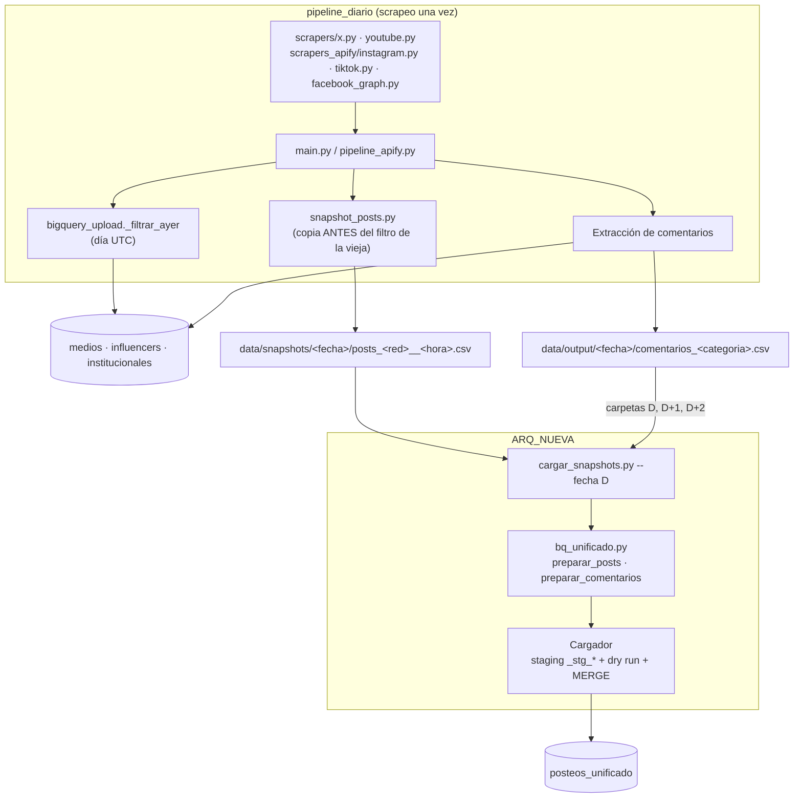
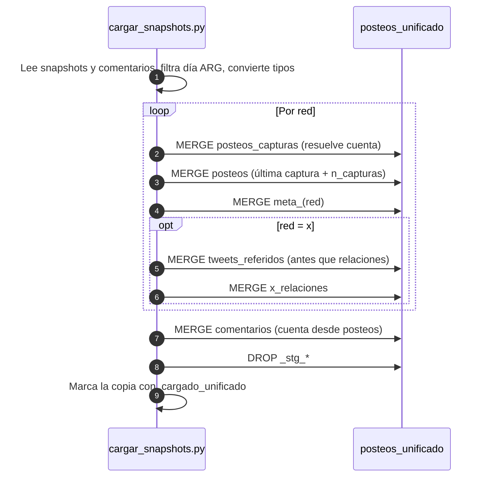

# 04 · Carga y pipelines

[← Índice](README.md)

## 1. Procesos que escriben en `posteos_unificado`

| Proceso | Script / bat | Qué carga | Frecuencia |
|---|---|---|---|
| Carga diaria desde snapshots | `ARQ_NUEVA/cargar_snapshots.py` + `bq_unificado.py` (bats `batHOY*.bat`, `batAYER*.bat`) | `posteos_capturas`, `posteos`, `meta_<red>`, `comentarios`, `x_relaciones`, `tweets_referidos` | Diaria |
| Scrapeo compartido para ambas arquitecturas | `ARQ_NUEVA/batAYER_AMBAS_SIN_IG_COM.bat`, `batHOY_FB_AMBAS.bat`, `batHOY_YT_TT_X_AMBAS.bat` | Scrapea una vez; la vieja sube como siempre y la nueva carga los snapshots | Diaria |
| Instagram a la nueva | `pipeline_diario/ig_a_arq_nueva.bat` | Posteos IG del día (copia de Apify) + comentarios IG copiados desde los datasets viejos | Diaria, después de la cola de comentarios IG |
| Sincronización desde la vieja | `pipeline_diario/sync_unificado.py` (`--desde`, `--horas`, `--solo-comentarios`) | Lo cargado en `medios`/`influencers`/`institucionales` → capturas, posteos, metas, comentarios, transcripciones | A demanda (recuperaciones) |
| Comentarios FB/X de 21 a 24 h ARG | `ARQ_NUEVA/comentarios_fb_21_24.py`, `comentarios_x_21_24.py` (`--extraer`, `--cargar`) | `comentarios` de los posteos de 21–24 h ARG que el selector de la vieja nunca pide (solo arquitectura nueva) | A demanda |
| Backfill de enunciadores | `ARQ_NUEVA/enunciadores/subir_bq_enunciadores.py` (`run_subir_enunciadores.bat`) | Cuentas nuevas + `proyecto_cuentas` + capturas, posteos, metas (2021-07 a 2025-12) | Puntual |
| Proyecto España | `España/subir_bq_espana.py` (`run_subir_bq_espana.bat`) + `España/armar_dimensiones.py` | Cuentas y `proyecto_cuentas` del proyecto `espana` + posteos de X, Instagram y TikTok (sin comentarios) | Puntual |
| Migración | `migracion_unificada/F4_sql_posteos_unificado/01…31` | Construcción completa desde backups | Única (re-ejecutable) |

## 2. Flujo diario



### Ventana de extracción con `SCRAPEO_COMPARTIDO=1`

| Red | Ajuste |
|---|---|
| X | Pide 2 días UTC y sube el límite por cuenta a 400; no filtra (cada arquitectura recorta). Trae campos extra de retweet/cita/respuesta. |
| YouTube | `publishedBefore` = D+1 02:59:59Z |
| Instagram, TikTok (Apify) | `_en_ventana` acepta también el día argentino (ts − 3 h) |
| Facebook (graph) | Sin cambios: ya extrae el día local completo |

Sin la variable, los scrapers se comportan exactamente como antes.

## 3. Orden de carga de un día



## 4. Opciones de `cargar_snapshots.py`

| Opción | Efecto |
|---|---|
| `--fecha hoy\|ayer\|AAAA-MM-DD` | Día argentino a cargar (default `ayer`) |
| `--ejecutar` | Escribe en BigQuery (exige `PIPELINE_UNIFICADO_BQ_OK=1`) |
| `--redes x,youtube` | Limita redes |
| `--sin-comentarios` | No carga comentarios |
| `--sin-comentarios-ig` | Carga comentarios salvo Instagram |
| `--carpeta-snapshots AAAA-MM-DD` | Lee los snapshots de otra carpeta (p. ej. el de X del día anterior cubre dos días) |
| `--reprocesar` | Vuelve a cargar copias ya marcadas |
| `--max-gb 2` | Tope de GB por consulta |

Variables de entorno: `BQ_UNIFICADO_DATASET` (dataset destino, default `posteos_unificado`), `PIPELINE_UNIFICADO_BQ_OK`, `ARQ_NUEVA_EJECUTAR` (bats), `SCRAPEO_COMPARTIDO`, `SNAPSHOT_POSTS=0` (apaga snapshots).

## 5. Seguridad y costo

1. Sin `--ejecutar` no se conecta a BigQuery: deja el SQL en `ARQ_NUEVA/sql_generado/<fecha>/`.
2. Con `--ejecutar` exige además `PIPELINE_UNIFICADO_BQ_OK=1`.
3. Cada `MERGE` se estima con **dry run** y se corta si supera `--max-gb`.
4. Todo `MERGE` filtra la tabla destino por el rango de meses del lote (`time_created` o `timestamp`) para podar particiones.
5. Staging temporal `_stg_*` con vencimiento de 1 día; se borra al terminar.
6. Las columnas a insertar se leen del esquema real del destino: columnas nuevas en el CSV no rompen la carga.

## 6. Estructura de carpetas relevante

```
Posteos/
├── ARQ_NUEVA/                    Cargadores y bats de la arquitectura nueva
│   ├── bq_unificado.py           Conversión al modelo + SQL MERGE + Cargador
│   ├── cargar_snapshots.py       Comando de carga diaria
│   ├── bat*.bat                  Lanzadores (HOY / AYER / AMBAS)
│   ├── enunciadores/             Subproyecto matriz de enunciadores
│   ├── sql_generado/<fecha>/     SQL generado en modo prueba
│   └── *.sql                     Chequeos de frescura, cobertura y diagnósticos
├── pipeline_diario/              Scrapeo diario (alimenta ambas arquitecturas)
│   ├── snapshot_posts.py
│   ├── sync_unificado.py
│   ├── ig_a_arq_nueva.bat
│   └── data/snapshots/ · data/output/
├── historico_mensual/            Backfills (HIST_PERFIL=enunciadores → data_enunciadores/)
├── migracion_unificada/          Construcción del dataset (fases, SQL 01…31, guías)
└── docs/arquitectura_nueva/      Esta documentación
```
