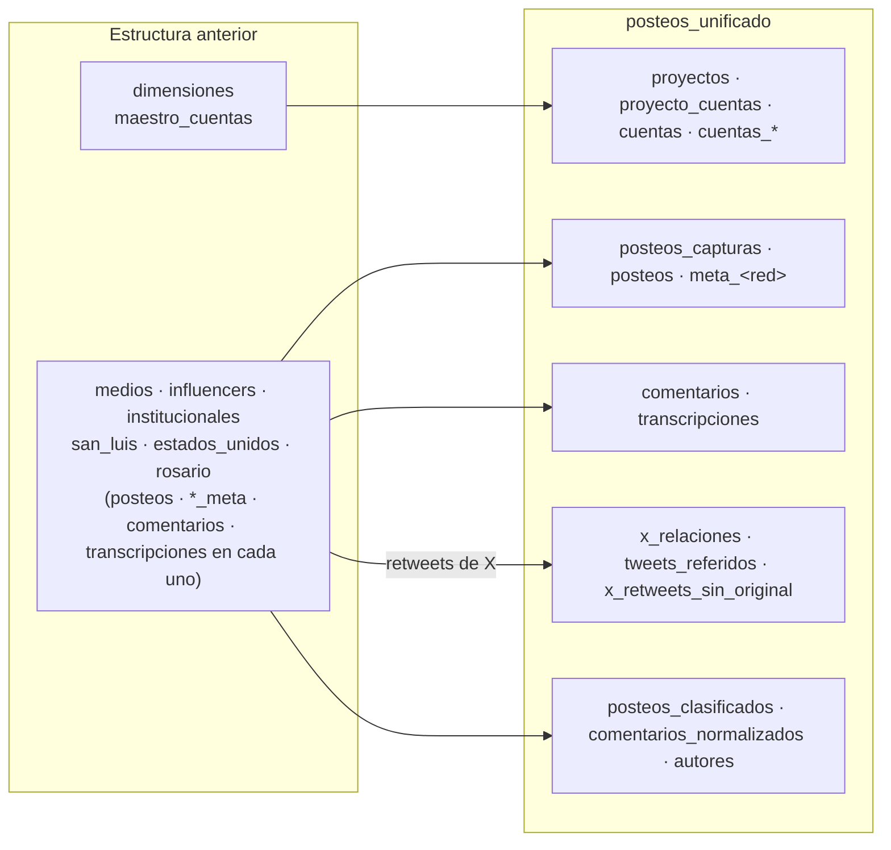

# 05 · Equivalencias con la estructura anterior

[← Índice](README.md)

Antes, los datos se organizaban en un dataset por categoría o proyecto (`medios`, `influencers`, `institucionales`, `san_luis`, `estados_unidos`, `rosario`) más un dataset `dimensiones`. Esta guía sirve para traducir consultas.



## Diferencias principales

| Antes | Ahora |
|---|---|
| Un dataset por categoría, con las mismas tablas repetidas | Un dataset; cada tabla incluye todas las categorías y proyectos |
| La categoría o el proyecto salían del dataset | `cuentas.categoria` y `proyecto_cuentas.proyecto_id` (o `v_posteos`) |
| `source`, `id`, `account_id` | `red`, `post_id`, `cuenta_id` (+ `account_id_origen`) |
| Fechas como texto | `TIMESTAMP` UTC con partición mensual |
| `posteos` con varias capturas mezcladas | `posteos_capturas` (historial) + `posteos` (última captura) |
| Comentarios: una fila por lectura | Una fila por comentario |
| En X, retweets y tweets ajenos dentro de `posteos` | Solo contenido propio; relaciones en `x_relaciones` |
| Perfil en `metadata_<red>` | `cuentas_perfil` (historial) + `v_cuentas_actual` |
| Día UTC | Día argentino |

## Columnas de posteos

| Antes (`<dataset>.posteos`) | Ahora (`posteos`) | Nota |
|---|---|---|
| `source` | `red` | minúscula; `twitter` → `x` |
| `id` | `post_id` | |
| `account_id` | `account_id_origen` | la cuenta resuelta es `cuenta_id` |
| `username`, `name`, `description`, `url` | ídem | |
| `comment_count`, `like_count`, `playcount` | ídem | ahora `INT64` |
| `time_created` (texto) | `time_created` | `TIMESTAMP` UTC |
| `scraped_at` (texto, hora argentina) | `scraped_at` | `TIMESTAMP` UTC |
| `nombre_normalizado` | ídem | |
| dataset (`medios`, …) | `categoria` (en `cuentas` / `v_posteos`) | |
| `<dataset>.<red>_meta` | `meta_<red>` | una fila por captura |

## Ejemplo de traducción

```sql
-- Antes
SELECT COUNT(*) FROM `cordoba-489013.medios.posteos`
WHERE source = 'Facebook' AND time_created LIKE '%/11/2026%';

-- Ahora
SELECT COUNT(*) FROM `cordoba-489013.posteos_unificado.v_posteos`
WHERE proyecto_id = 'cordoba' AND categoria = '<categoria de medios>' AND red = 'facebook'
  AND time_created >= TIMESTAMP('2026-11-01 03:00:00') AND time_created < TIMESTAMP('2026-12-01 03:00:00');
```

## Diferencias esperables al comparar resultados

| Red | Ahora vs. antes | Motivo |
|---|---|---|
| Facebook | Más posteos por día | El día argentino incluye las publicaciones de 21 a 24 h que antes caían en el día siguiente |
| X | Menos posteos | Los retweets dejaron de contarse como posteos de la cuenta |
| Todas | Menos filas de comentarios | Una fila por comentario en lugar de una por lectura: comparar comentarios distintos |
