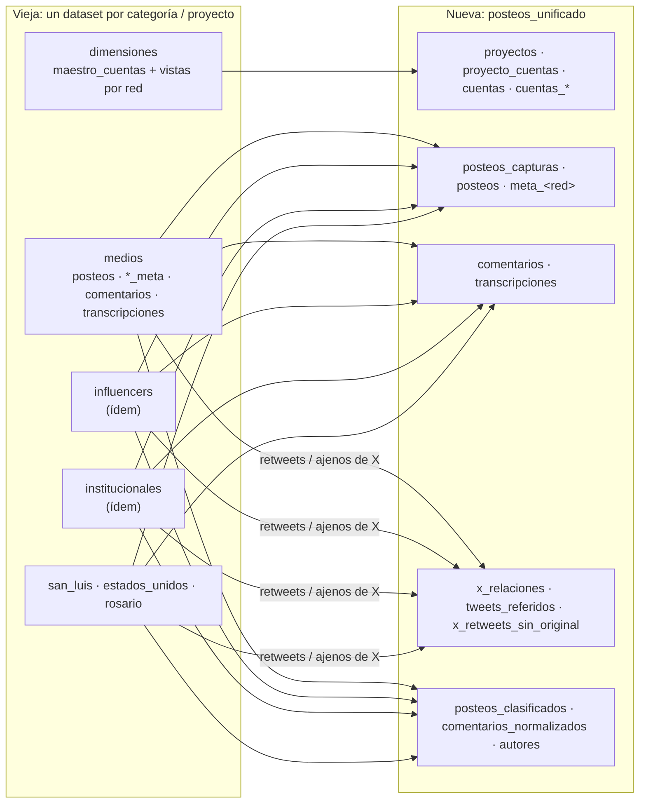

# 06 · Migración y estado

[← Índice](README.md)

## 1. Arquitectura vieja vs. nueva

| Vieja | Nueva |
|---|---|
| Un dataset por categoría con `posteos`, `*_meta`, `comentarios`, `transcripciones` en cada uno | Un dataset; cada tabla con todas las categorías y proyectos |
| `source`, `id`, `account_id` (texto) | `red`, `post_id`, `cuenta_id` + `account_id_origen` |
| `scraped_at` / `time_created` como texto | `TIMESTAMP` UTC, partición mensual |
| Proyecto implícito por dataset | Proyecto por `proyecto_cuentas`; hechos sin proyecto |
| Retweets y tweets ajenos mezclados en `posteos` de X | Separados en `x_relaciones` / `tweets_referidos` / `x_retweets_sin_original` |
| Perfil en `metadata_<red>` (una fila por cuenta) | `cuentas_perfil` con historial + `v_cuentas_actual` |
| Maestro en `dimensiones.maestro_cuentas` | `cuentas` + `proyecto_cuentas` + `cuentas_alias` |
| `posteos` append-only con varias capturas mezcladas | `posteos_capturas` (historial) + `posteos` (última) |
| Comentarios: una fila por captura | Una fila por comentario (última captura) |
| Corte de día UTC (pierde 21–24 h ARG) | Corte por día argentino |

## 2. Mapeo de columnas (posteos)

| Vieja (`<dataset>.posteos`) | Nueva (`posteos_capturas` / `posteos`) | Transformación |
|---|---|---|
| `source` | `red` | minúscula; `twitter` → `x` |
| `id` | `post_id` | STRING |
| `account_id` | `account_id_origen` | tal cual; `cuenta_id` se resuelve aparte |
| `username`, `name`, `description`, `url` | ídem | tal cual |
| `comment_count`, `like_count`, `playcount` | ídem | texto → INT64 |
| `time_created` (texto UTC) | `time_created` | `PARSE dd/mm/aaaa hh:mm:ss` como UTC |
| `scraped_at` (texto ARG o ISO Z) | `scraped_at` | ARG + 3 h → UTC |
| `nombre_normalizado` | ídem | — |
| dataset (`medios`, …) | — | se reemplaza por `cuentas.categoria` y `proyecto_cuentas` |
| `<dataset>.<red>_meta` | `meta_<red>` | una fila por captura; `scraped_ts_inferido` si faltaba `scraped_at` |

## 3. Secuencia de construcción

`migracion_unificada/F4_generar.py AAAAMMDD` genera `F4_sql_posteos_unificado/` (33 SQL) a partir de `F1_sql_posteos_unificado_test2/`.

| Pasos | Bloque | Scripts |
|---|---|---|
| 01–03 | Dimensiones | `01_B1c_crear_dimensiones`, `02_B1e_aplicar_correcciones`, `03_F1_03_alias_vacio` |
| 04–09 | Capturas y cuentas | `04/10_B2b_crear_posteos_capturas`, `05_B2e_completar_cuentas`, `06_B2n_crear_cuentas_perfil`, `07_B2u…`, `07b`, `07c_vista_cuentas_actual`, `08_B2x_cerrar_pendientes`, `09_B2y_normalizar_usernames` |
| 11 | Posteos, metas y vista | `11_F1_05_posteos_metas_vista`, `11b_F1_06_vista_y_verificacion` |
| 12–16 | Contenido y enriquecimientos | `12_B2g_crear_transcripciones`, `13_B2i_crear_comentarios`, `14_B2k_crear_enriquecimientos`, `15_F1_07_clasificados_bert_v1`, `16_B2zc_completar_cuenta_comentarios` |
| 17 | Conciliación | `17_F1_17_conciliacion` |
| 18–28 | X | `18_F1_10_x_preparar` → `19_X2` → `20_X2b` → `21_X4a` → `22_X4c` → `23_X4b3` → `24_X4b4` → `25_X4c` → `26_X4b3` → `27_X4b5` → `28_X4f` |
| 29 | Comparación con referencia | `29_F1_90_comparar_con_referencia` |
| 30–31 | Hechos sin proyecto | `30_quitar_proyecto_id_dataset_origen`, `31_…_transcripciones` |

> En X el orden importa: `X4c` calcula el id dominante usando el retweet con envoltorio como mejor señal y `X4b4` lo borra de `posteos_capturas`; por eso `X4c` y `X4b3` se repiten.

Resultados de X: retweets con envoltorio retirados de `posteos` 140.844 (16.063 con relación; 124.781 a `x_retweets_sin_original`); tweets de autores ajenos retirados 163.768; posteos de X sin cuenta: 635.199 → 25–27.

## 4. Fases

```mermaid
flowchart LR
    F0["F0 Decisiones<br/>e inventario"]:::ok --> F1["F1 Secuencia<br/>re-ejecutable (test2)"]:::ok
    F1 --> F2["F2 Backups<br/>bk_*_20261104"]:::ok
    F2 --> F3["F3-F4 Construcción<br/>en producción"]:::ok
    F3 --> F5["F5 Conciliación<br/>y claves únicas"]:::pend
    F5 --> F6["F6 Cargadores<br/>diarios"]:::curso
    F6 --> F7["F7 Semana<br/>en paralelo"]:::curso
    F7 --> F8["F8 Corte"]:::pend
    F8 --> F9["F9 Retiro de datasets viejos<br/>(30 días + aprobación)"]:::pend
    classDef ok fill:#d4edda,stroke:#2e7d32
    classDef curso fill:#fff3cd,stroke:#b8860b
    classDef pend fill:#eeeeee,stroke:#777
```

| Fase | Estado |
|---|---|
| 0–4 y paso 31 | Hecho (04/11/2026) |
| 5 Conciliación contra `bk_*_20261104`, unicidad de claves, muestra de informes sobre `v_posteos` | Pendiente |
| 6 Cargadores | En uso: `cargar_snapshots.py`, `ig_a_arq_nueva.bat`, `sync_unificado.py`, comentarios 21–24 h; falta el de transcripciones |
| 7 Paralelo | En curso desde el 03/11: ambas arquitecturas se alimentan del mismo scrapeo; cobertura semanal comparada vieja vs. nueva |
| 8 Corte | Pendiente |
| 9 Retiro | A los 30 días del corte, con aprobación escrita |

## 5. Diferencias esperadas en el paralelo (03/11 a 07/11/2026)

| Red | Nueva vs. vieja (posts/día) | Motivo |
|---|---|---|
| Facebook | +38 a +55 | La vieja pierde 21–24 h ARG por su corte UTC |
| X | −95 a −193 | Retweets con envoltorio van a `x_relaciones`, no a `posteos` |
| IG / TikTok / YouTube | −4 a −32 (03–05/11) | Posts recuperados en la vieja con bats de recuperación que no estaban en los snapshots |

## 6. Pendientes conocidos

1. Fase 5 completa (conciliación y claves únicas).
2. Cargador de `transcripciones` para la nueva.
3. Resolver `x_retweets_sin_original` con el timeline (`X4e`); timeline cargado solo hasta el 27/10.
4. 70 cuentas de EE.UU. sin id; 29 cuentas fuera del maestro a revisar; 3 perfiles pendientes y 22 cuentas sin perfil.
5. 49 `cuentas_pendientes` de `enunciadores` a resolver tras la extracción.
6. Confirmar con Franco la regla de captura de `tweets_referidos` (primera captura).
7. Comentarios IG de la cola manual: suben a la vieja y se copian con `sync_unificado.py --solo-comentarios`.
8. Acceso restringido a `posteos_unificado` (IAM): fuera de alcance por ahora.
9. Retirar respaldos `bk_x4b4_*` / `bk_x4b5_*` al cerrar la Fase 5.
